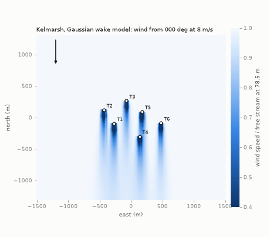
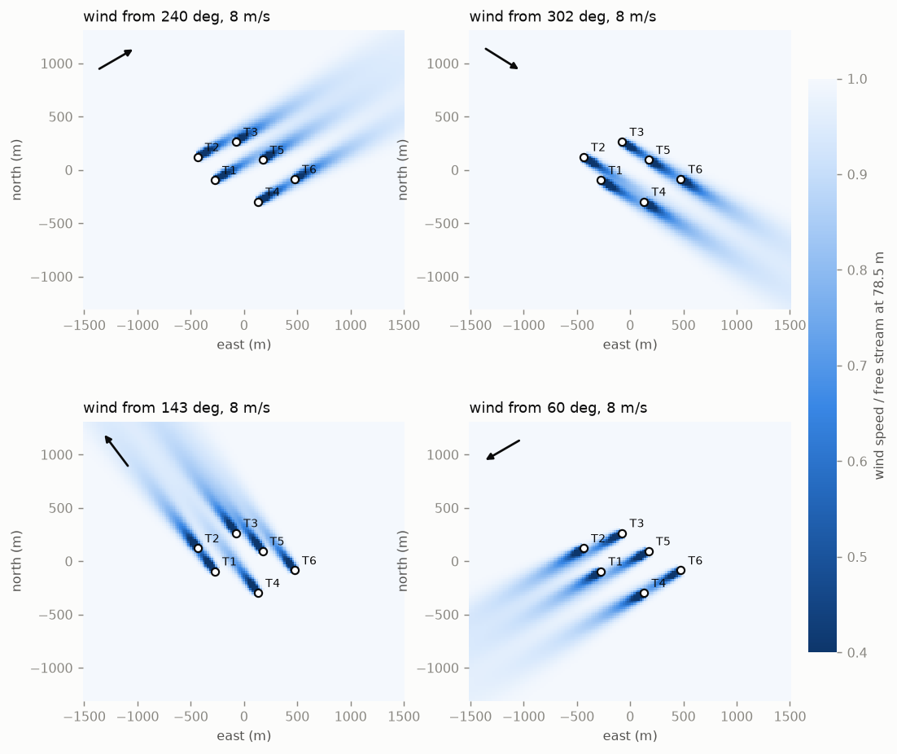
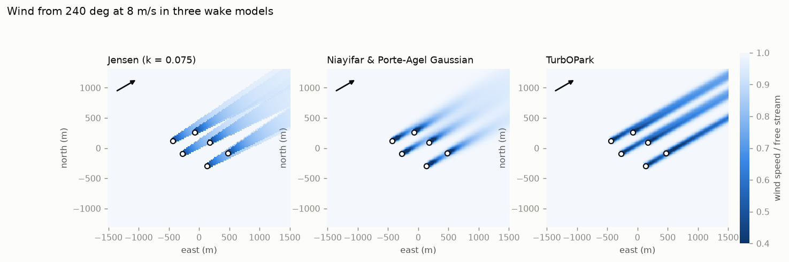
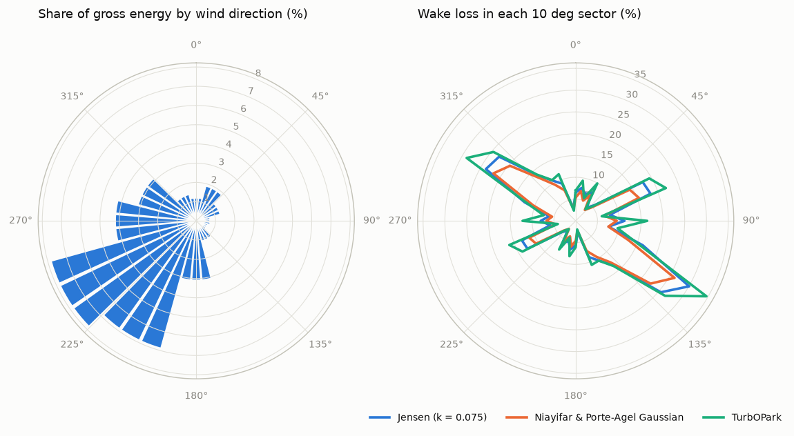
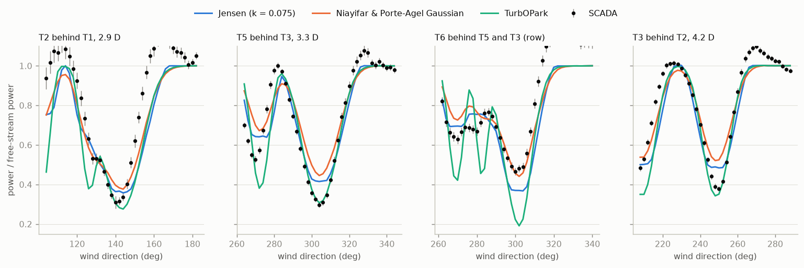
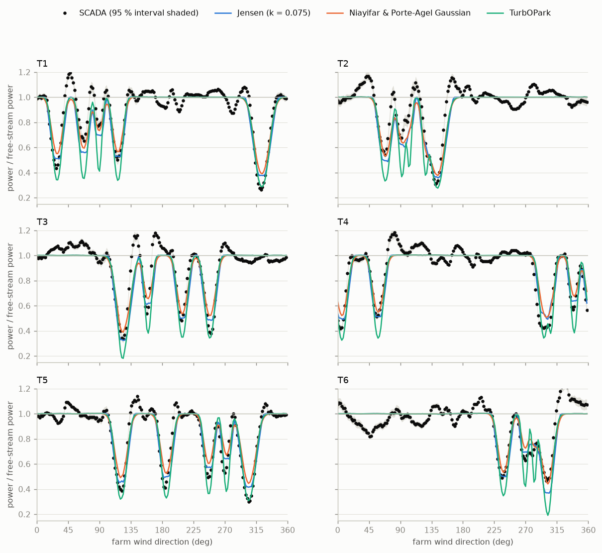
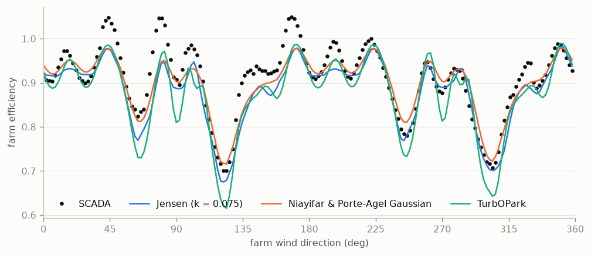
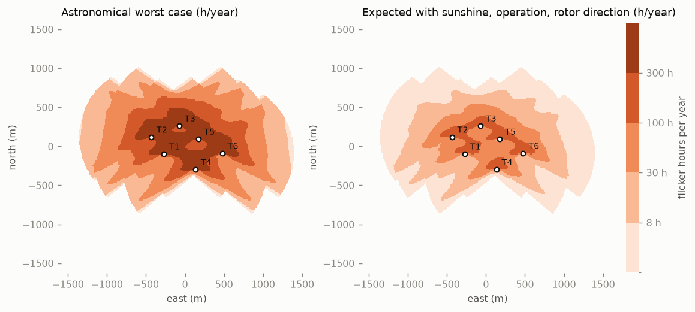
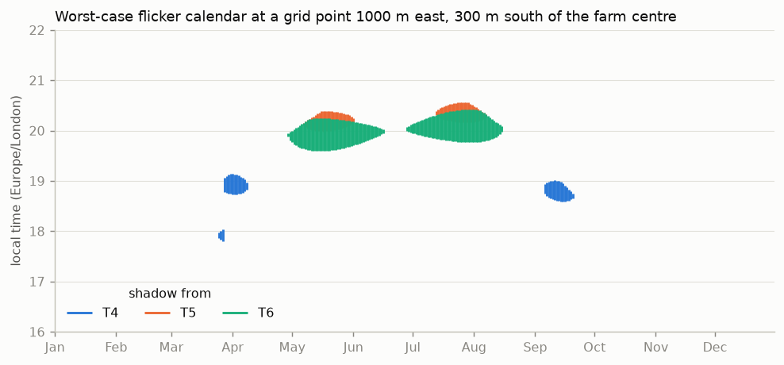

# Kelmarsh wind farm: wakes and shadow flicker

[](https://github.com/kwwaleszczynski-del/wind-wake-shadow/actions/workflows/ci.yml)

Wake flow maps, wake losses and shadow flicker maps for the six-turbine Kelmarsh wind farm (Senvion MM92, UK),
built on the open SCADA dataset published by Cubico. Three engineering wake models are run on the real layout
with PyWake and checked against six years of 10-minute SCADA; shadow flicker is mapped on a regular grid with an
analytic sun-path model, as an astronomical worst case and as an expected case using measured sunshine, rotor
operation and rotor orientation.

**Interactive version:** [kwwaleszczynski-del.github.io/wind-wake-shadow](https://kwwaleszczynski-del.github.io/wind-wake-shadow/)
(animated flow map, turbine-by-turbine model comparison, switchable flicker maps).



## Results at a glance

- **Annual wake loss** over the measured wind climate: 7.7 % with the Niayifar & Porte-Agel Gaussian model,
  9.0 % with Jensen (k = 0.075) and 10.0 % with TurbOPark (gross AEP 34.9 GWh from nacelle wind speeds).
- **Against SCADA** (159,289 ten-minute records with all six turbines in partial load, 2016-2021) the measured
  wake loss in the sample is **9.2 %**. The Gaussian model gives 9.7 %, Jensen 11.4 %, TurbOPark 12.1 %. The
  Gaussian model also has the smallest error in the waked direction bins (RMSE 0.106 of free-stream power, vs
  0.117 Jensen and 0.133 TurbOPark).
- **No single model gets every wake right.** At the closest spacing (2.9-3.3 rotor diameters) the measured
  single wakes are deeper and narrower than Jensen and Gaussian predict (power drops to 0.26-0.31 of free stream,
  Gaussian 0.38-0.45); TurbOPark matches them (0.28-0.31) but is too deep further downstream and far too deep in
  the T3-T5-T6 row (0.19 vs 0.46 measured for T6).
- **The SCADA wind direction is well calibrated**: shifting the measured curves by -8 to +8 deg, the best match to
  the model is at +2 deg, one direction bin.
- **Shadow flicker**: the astronomical worst case exceeds 30 h/year on 2.4 km² around the farm, up to 860 m from
  the nearest turbine. Sunshine (23-43 % of daylight hours, Met Office Oxford), rotor operation (~90 % of
  daylight time) and rotor orientation bring the expected hours down to **20 % of the worst case**; 2.0 km² still
  sees more than 8 h/year in that expected case.

## 1. Wake flow maps



Hub-height wind speed relative to the free stream at 8 m/s in the Gaussian model. The farm is a loose cluster,
so most directions line up at least one pair: north-west and south-east winds along T2-T1 (2.9 D) and the
T3-T5-T6 row, south-west winds (the prevailing ones) along T2-T3, T1-T5 and T4-T6.



The three models differ most in the far wake: Jensen's top-hat wake expands linearly and keeps a sharp edge,
the Gaussian wake recovers quickest at this site's turbulence (12.7 %), TurbOPark keeps a narrow, deep wake for
kilometres.

## 2. Wind climate, AEP and where the losses come from



The wind climate comes from SCADA: for each 10-minute record, the mean nacelle wind speed of the turbines that
are in free stream for that direction (IEC 61400-12-1 disturbed sectors), scaled to 78.5 m; Weibull fits in 12
sectors. 44 % of the gross energy comes from 195-255 deg.

| model | gross AEP (GWh) | net AEP (GWh) | wake loss |
|---|---:|---:|---:|
| Jensen (k = 0.075) | 34.92 | 31.78 | 9.0 % |
| Niayifar & Porte-Agel Gaussian | 34.92 | 32.23 | 7.7 % |
| TurbOPark | 34.92 | 31.44 | 10.0 % |

Per turbine (Gaussian model) the losses range from 3.3 % for T2 (upwind in the prevailing directions) to 11.5 %
for T5 in the middle of the farm. The worst 10-deg sectors lose 20-26 % (120-130 deg and 300-310 deg, along
the T3-T5-T6 row) but carry little energy; the prevailing 240-250 deg sectors lose 10-11 %. Per-turbine and
per-sector tables: [`results/aep_by_turbine.csv`](results/aep_by_turbine.csv),
[`results/wake_loss_by_sector.csv`](results/wake_loss_by_sector.csv).

## 3. Models against SCADA

The comparison asks one question per turbine and direction: how much power does the turbine produce relative to
the turbines that are in free stream at the same time?





| | wake loss in the sample | RMSE in waked bins |
|---|---:|---:|
| SCADA (measured) | 9.2 % | |
| Jensen (k = 0.075) | 11.4 % | 0.117 |
| Niayifar & Porte-Agel Gaussian | 9.7 % | 0.106 |
| TurbOPark | 12.1 % | 0.133 |

Deepest normalised power of the downstream turbine within +-15 deg of full alignment (selection from
[`results/pair_deficits.csv`](results/pair_deficits.csv)):

| downstream behind upstream | spacing | wind from | SCADA | Jensen | Gaussian | TurbOPark |
|---|---:|---:|---:|---:|---:|---:|
| T2 behind T1 | 2.9 D | 143 deg | 0.31 | 0.36 | 0.38 | 0.28 |
| T1 behind T2 | 2.9 D | 323 deg | 0.26 | 0.38 | 0.39 | 0.29 |
| T5 behind T3 | 3.3 D | 304 deg | 0.30 | 0.42 | 0.45 | 0.31 |
| T6 behind T5 (and T3) | 3.8 D | 301 deg | 0.46 | 0.37 | 0.44 | 0.19 |
| T3 behind T2 | 4.2 D | 248 deg | 0.38 | 0.48 | 0.52 | 0.34 |
| T6 behind T4 | 4.4 D | 238 deg | 0.49 | 0.50 | 0.53 | 0.35 |
| T5 behind T1 | 5.3 D | 247 deg | 0.49 | 0.57 | 0.61 | 0.36 |

What the comparison shows:

- In the row T3-T5-T6 the **second waked turbine produces more than the first** (T6 0.46, T5 0.30): the
  turbulence added by the first wake speeds up the recovery of the second. The Gaussian model, whose wake
  expansion grows with the turbulence at the wake-generating turbine, gets close (0.44); Jensen with a fixed
  expansion is too deep (0.37) and TurbOPark much too deep (0.19).
- Averaging the model over a Gaussian spread of wind direction (sigma 2.5-7.5 deg, often used to mimic 10-minute
  averaging) makes the fit worse for Jensen and Gaussian ([`results/validation_summary.csv`](results/validation_summary.csv)):
  the measured wakes are already narrow, so the farm-mean direction from six nacelle vanes is a good
  reference.
- Outside the wakes the measured curves wander between 0.85 and 1.15. Those are direction-dependent terrain and
  roughness effects (ground elevation varies by 22 m across the site) that one site factor per turbine cannot
  remove. They add the same error to every model.



## 4. Shadow flicker



Hours of flicker per year on a 10 m grid (3.2 x 3.2 km), with no buildings, terrain or screening: the maps show
where flicker is geometrically possible, not who would see it.

| | value |
|---|---:|
| worst case, maximum on the grid (next to a tower) | 1,078 h/year, 389 min/day |
| area above 30 h/year (worst case) | 2.4 km² |
| area above 30 min on the worst day | 2.6 km² |
| furthest point above 30 h/year from the nearest turbine | 860 m |
| expected case / worst case, summed over the grid | 0.20 |
| area above 8 h/year (expected case) | 2.0 km² |

The 30 h/year, 30 min/day (worst case) and 8 h/year (expected case) values are the reference values of the
German LAI guidance, the most widely used numeric limits; they are shown as reference lines only, not as a
compliance assessment.



The calendar shows when flicker happens at one arbitrary grid point 1 km east of the farm: evening shadows of
T4-T6 from late March to mid-September, 68 h/year in the worst case.

## Method

**Wake model choice: PyWake (DTU).** PyWake runs the same simulation object for AEP with and without wakes over a
Weibull wind rose (one call each), for time series of measured inflow and for flow maps; it handles the two hub
heights as turbine types and ships literature implementations of the three model families compared here. It is
a pip-installable pure-Python package, which keeps CI simple. FLORIS (NREL) would work as well; it is built
around wind farm control (yaw and wake steering), which this project does not need.

**Turbine.** Senvion MM92 catalogue power curve (Open Energy Platform turbine library, 1.225 kg/m³). No Ct
curve is public, so Ct comes from PyWake's generic turbine model for the same rotor and rating (Ct 0.8 in
partial load, momentum theory above rated); its own power curve stays within 70 kW of the catalogue curve. T3
and T6 have 68.5 m hubs, the others 78.5 m; power-law shear 0.2.

**Models.** Jensen (1983) with k = 0.075 and squared-sum superposition; Niayifar & Porte-Agel (2016) Gaussian
wake with Crespo-Hernandez added turbulence and linear superposition; TurbOPark (Nygaard et al. 2022) as
implemented in PyWake (squared-sum superposition, ground mirror). Ambient
turbulence intensity 12.7 %: the median nacelle-anemometer TI of free-stream turbines at 7.5-8.5 m/s.

**SCADA comparison.** Records where all six turbines produce more than 20 kW with blade pitch below 5 deg
(no stops, derating or curtailment) and a wind direction. Farm direction: circular mean of the six nacelle
direction signals (nacelle position + vane; they agree to within a few degrees). Free-stream turbines per direction from the IEC 61400-12-1
Annex A disturbed sectors. Each turbine's power is divided by a site factor (its power relative to the other
free turbines when it is itself free, iterated to a fixed point); the reference wind speed is the free-stream
power inverted on the catalogue curve, kept between 5 and 10 m/s. Every record is run through each model at its
own wind speed and direction and processed exactly like the measurements. Bins are 2 deg wide; the 95 %
interval uses the number of distinct days as the sample size.

**Shadow flicker.** During one day the sun moves on a circle of almost constant declination at 15 deg of hour
angle per hour. Seen from a receptor, a rotor facing the sun covers a cap of angular radius atan(R/d) around the
hub, so the time the sun spends behind it has a closed form; one (receptor, turbine, day) costs a few array
operations instead of 1,440 sun positions, and the tests check it against 1-minute time stepping (agreement
within 1 %). Overlapping shadows of two turbines count once. Assumptions: flat terrain, receptors 2 m above
ground, sun at least 3 deg above the horizon, shadow within 10 rotor diameters (UK practice). Expected case =
worst-case minutes per turbine and month x monthly sunshine fraction (Met Office Oxford, 1991-2020 normal) x
share of daylight time the rotor turned x mean |cos| of the angle between the rotor axis and the
receptor-turbine line, both from SCADA 2016-2021.

## Limitations

- **Nacelle anemometry.** The wind climate and TI come from anemometers behind the rotor (no met mast), so the
  absolute AEP is indicative; wake losses in percent are much less sensitive.
- **Measured loss is a sample loss.** The 9.2 % holds for partial-load records with every turbine running; it
  is not the annual wake loss, and the comparison does not test the models above rated wind speed.
- **No thrust curve from the manufacturer**, a generic one; shear exponent assumed, not measured.
- **Terrain.** Neither the wake models nor the flicker model include terrain; the site is gently rolling (ground
  elevation 135-157 m at the turbines).
- **Expected flicker** treats sunshine, operation and wind direction as independent and uses monthly averages;
  sunshine comes from a station 75 km away. The yaw factor scales the shadow duration with the rotor's
  projected width, an approximation for low sun.

## Reproduce

```bash
python -m venv .venv
.venv/Scripts/pip install -e ".[dev]"        # Linux/macOS: .venv/bin/pip
pytest -q                                      # 50 tests, offline, ~20 s
python -m wind_wake_shadow fetch               # Kelmarsh SCADA 2016-2021 from Zenodo (~1.7 GB) + Met Office file
python -m wind_wake_shadow run                 # ~4 min: results/, docs/img/, docs/index.html
```

Already have the Kelmarsh data from the companion
[wind-power-curve-kelmarsh](https://github.com/kwwaleszczynski-del/wind-power-curve-kelmarsh) project? Point
`--data-dir` (or `KELMARSH_DATA_DIR`) at its `data` folder; its Parquet cache is reused and only the small
Met Office file is downloaded (`fetch --sunshine-only`).

```
src/wind_wake_shadow/
  kelmarsh.py    Zenodo download, Greenbyte CSV reader, Parquet cache, turbine metadata
  layout.py      local coordinates, bearings, IEC 61400-12-1 free-stream sectors
  turbine.py     Senvion MM92 power and thrust curves for PyWake
  wake.py        wind climate, wake models, AEP, sector losses, flow maps
  validation.py  SCADA record selection, site factors, binned normalised power, metrics
  shadow.py      sun position, analytic flicker model, brute-force check, expected case
  sunshine.py    Met Office station file, monthly sunshine fraction
  pipeline.py    the analysis steps
  plots.py       PNG charts and the GIF
  web.py         the Plotly page in docs/
  cli.py         command line
```

## Data and licences

- **Kelmarsh wind farm data**: C. Plumley and R. Takeuchi, Cubico Sustainable Investments,
  [doi:10.5281/zenodo.16807551](https://doi.org/10.5281/zenodo.16807551), licence
  [CC-BY-4.0](https://creativecommons.org/licenses/by/4.0/). Raw data are not stored in this repository.
- **Sunshine**: Met Office historic station data, Oxford. Contains Met Office data © Crown copyright,
  [Open Government Licence v3.0](https://www.nationalarchives.gov.uk/doc/open-government-licence/version/3/).
- **MM92 power curve**: Open Energy Platform wind turbine library (oedb), via windpowerlib.
- Code: MIT licence, see [LICENSE](LICENSE).
